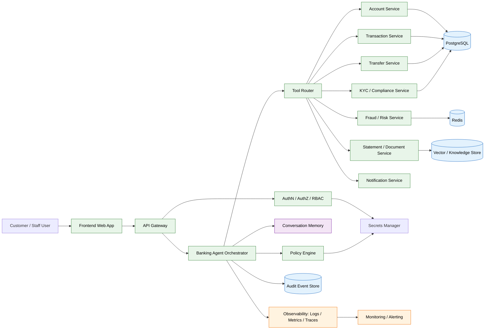

# Secure Banking Agent Demo

This repository presents an architecture for a secure, enterprise-ready banking agent demo that can handle customer-facing banking tasks while enforcing security, compliance, and operational controls.

## Overview

The solution combines a modern frontend, an API gateway, an agent orchestration layer, and secure banking backend services. The agent interprets user requests, decides which banking tools to call, and ensures that sensitive actions are policy-checked before execution.

## Core Architecture

### 1. User Experience Layer
- Customer web application
- Support or operations portal
- Mobile-ready endpoints for banking interactions

### 2. Gateway and Identity Layer
- API Gateway for routing, TLS termination, rate limiting, and request validation
- Authentication and authorization using OIDC/OAuth2 and RBAC
- Consent and access policy enforcement for regulated actions

### 3. Agent Orchestration Layer
- Conversational agent runtime that interprets user intent
- Tool routing to appropriate banking services
- Memory and context for multi-turn conversations
- Safety checks before executing high-risk operations

### 4. Banking Service Layer
- Account lookup and balance services
- Transaction history retrieval
- Funds transfer workflow
- Fraud and risk analysis
- KYC and compliance verification
- Statement and document retrieval
- Notifications and alerts

### 5. Data and Knowledge Layer
- Relational database for transactional banking data
- Cache and session store for fast access and rate limiting
- Vector or knowledge store for policy and product documentation retrieval
- Event/audit store for compliance and investigations

### 6. Security and Compliance Layer
- Secret management for credentials and API keys
- Encryption in transit and at rest
- PII masking and redaction
- Audit logging for all sensitive operations
- Approval workflow for transactions above threshold or policy-defined risk

### 7. Observability and Operations
- Centralized logs
- Metrics and traces
- Alerts for failures, anomalies, or suspicious activity
- Performance monitoring and system health dashboards

## Reference Architecture

## Security Principles

- Principle of least privilege for every service and user role
- Strong authentication and authorization for all sensitive operations
- Explicit human approval for high-risk or high-value transactions
- Comprehensive auditability for every action taken
- Data minimization and privacy-first handling of customer information

## Example Banking Use Cases

- "Check my account balance"
- "Show recent transactions"
- "Transfer $250 to my savings account"
- "Explain a suspicious transaction"
- "Find my latest statement"
- "Report a lost debit card"

## Recommended Technology Stack

This demo can be implemented with a modern stack such as:

- Frontend: React, Next.js, or similar
- Backend: Python (FastAPI) or Node.js (Express/NestJS)
- LLM orchestration: LangChain, OpenAI-compatible APIs, or custom agent runtime
- Database: PostgreSQL
- Cache: Redis
- Search/knowledge: vector database or document search engine
- Monitoring: Prometheus/Grafana, OpenTelemetry, or equivalent
- Secret management: Azure Key Vault, AWS Secrets Manager, or HashiCorp Vault

## Notes

This repository is currently a foundational architecture and documentation scaffold. It can be extended into a full working demo with the actual code, integrations, and test setup for a real banking agent application.

## Future Enhancements

- Add live banking API integrations
- Implement idempotent money transfer workflows
- Integrate fraud detection models
- Add auditing and compliance dashboards
- Support multi-region and failover deployment
- Add end-to-end tests and security validation

---

This README is intended to establish a starting point for a secure banking agent architecture and can be expanded as actual application code is added.
